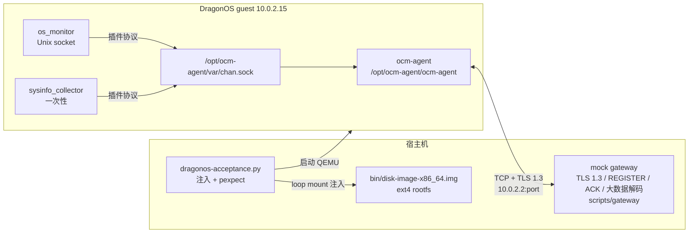

# ocm-agent DragonOS 端到端验收报告

本文记录 ocm-agent（含 `os_monitor`、`sysinfo_collector`）在 DragonOS 上的**完整运行方式、引用关系、实际产出和验收结论**。原始数据见
[`test-results/2026-10-25/`](./test-results/2026-10-25/)。

## 1. 结论

在 DragonOS `6.6.21-dragonos #5` 上，ocm-agent 的完整链路已跑通：

- 首次注册：TCP + TLS 1.3 → REGISTER → gateway 签发客户端证书 → mTLS 重连；
- 心跳、小数据上报与 ACK、大数据分片拉取；
- 真实插件 `os_monitor`、`sysinfo_collector` 采集并经 Unix socket → agent → TLS 上报；
- gateway 侧可完整解码 `PluginData → MetricsData → Metric(name/value/tags)`；
- 运行期间 agent 无 error，仅 `chattr +i` 因 DragonOS 未实现 `FS_IOC_SETFLAGS` 产生一条警告。

验收脚本判定 **PASS**。

## 2. 前置条件

### 2.1 主机环境

| 依赖 | 用途 |
|---|---|
| Linux x86_64 + `/dev/kvm` | QEMU/KVM 运行 DragonOS |
| Nix（flake） | 构建内核（`nix develop`） |
| Go ≥ 1.25 + `musl-gcc` | 构建 agent（cgo/sqlite 静态链接）、插件、mock gateway |
| QEMU + `make` | `make qemu-nographic` 启动 |
| Python 3 + `pexpect` | 驱动串口、执行 guest 脚本 |
| 免密 `sudo` | loop 挂载 ext4 镜像，注入测试文件 |
| `gh`（可选） | 创建内核/busybox 修复 PR |

### 2.2 仓库与引用关系

```text
DragonOS 仓库
├── user/apps/ocm-agent/
│   ├── Makefile                 ← 从 DADK 缓存/本地 upstream 构建静态 agent 和插件
│   ├── default.nix              ← Nix：fetchgit 固定 commit，pkgsStatic.buildGoModule
│   ├── scripts/gateway/         ← 协议兼容 mock gateway（TLS/注册/ACK/大数据解码）
│   ├── scripts/dragonos-acceptance.py
│   ├── scripts/dragonos-smoke.py
│   └── upstream/                ← 本地直接编译时的源码（未跟踪，可选）
├── user/apps/default.nix        ← 把 ocm-agent 加入 Nix rootfs
└── user/dadk/config/...         ← DADK 构建/安装配置
```

ocm-agent 源码**不在 DragonOS 仓库内**，通过两处引用同一个 GitHub 镜像：

| 引用点 | 地址/版本 |
|---|---|
| DADK `user/dadk/config/all/ocm_agent.toml` | `source = "git"`，`source-path = "https://github.com/sparkzky/ocm-agent.git"`，`revision = d08b700e20243cee892ef67b975f89500f352c4b`（`dragonos` 分支） |
| Nix `default.nix` | `fetchgit` 同一仓库，`rev = d08b700...`，`hash = sha256-84ybp...` |

DADK 的 `build-command` 通过 `DADK_SOURCE_CACHE_DIR_OCM_AGENT_0_1_0` 使用它克隆的
源码目录，因此不需要 submodule。本地直接 `make -C user/apps/ocm-agent` 时，先执行
`make -C user/apps/ocm-agent fetch-src` 把源码克隆到未跟踪的 `upstream/`。

镜像仓库的 `master` 是 Gitee 上游的纯净镜像；`dragonos` 分支包含两个可移植性修复（见 §7）。
DADK 首次构建会克隆到 `bin/dadk_cache/source/ocm_agent_0_1_0`；本地直接编译则克隆到
未跟踪的 `upstream/`。GitHub 访问受限时可预先准备同 commit 的源码缓存。

> 内核 `/proc/uptime` 与 busybox 构建修复已通过
> [PR #2565](https://github.com/DragonOS-Community/DragonOS/pull/2565) 和
> [PR #2566](https://github.com/DragonOS-Community/DragonOS/pull/2566) 合入 `master`。
> 本分支已 rebase 到包含这两处修复的 `master`；2026-10-26 rebase 后重新执行本验收，
> 结果仍为 PASS，工作区不再保留额外修改。详见 §7 和 §9。

## 3. 测试拓扑



- QEMU 用户态网络中，guest 通过 `10.0.2.2` 访问宿主机 loopback 上的 mock gateway。
- mock gateway 是协议兼容测试替身，不是生产 gateway 服务；它实现了注册、证书签发、
  `DATA_SMALL` ACK、`DATA_REQ_NEW → FRAG → FINISH` 大数据流程，并用真实 proto 解码数据。
- 大数据测试额外把同一个静态 gateway 二进制注入 guest，用其 `-push-socket` 模式向 agent
  发送 120KB 合成插件数据，验证 guest 内的大数据分片路径。

## 4. 如何运行

### 4.1 构建内核与镜像

```bash
# 1) 内核（需要内核 /proc/uptime 修复）
make kernel

# 2) agent + 插件（静态）
make -C user/apps/ocm-agent all plugins

# 3) DADK 安装 + 写镜像
make user
SKIP_GRUB=1 make write_diskimage
```

也可以直接：

```bash
make run-nographic      # 编译 + 写镜像 + 启动 QEMU
```

### 4.2 一条命令执行端到端验收

```bash
python3 user/apps/ocm-agent/scripts/dragonos-acceptance.py --duration 60
```

参数：

- `--duration 60`：agent 在 guest 内运行 60 秒（至少覆盖注册、两次插件推送、大数据会话）；
- `--settle 20`：agent 启动后等待 20 秒再注入 120KB 合成大数据；
- `OCM_SMOKE_RUNNER`：默认 `make qemu-nographic`，可改为其他启动命令。

### 4.3 脚本内部步骤

1. 构建 agent、插件和静态 mock gateway；
2. 生成一次性 CA、服务端证书和 `CN=1001` 客户端证书；
3. loop 挂载 `bin/disk-image-x86_64.img`（偏移 1 MiB），注入：
   - agent 二进制、`config.yaml`、`ca.crt`（首次注册不预置客户端证书）；
   - `os_monitor`、`sysinfo_collector` 二进制与插件配置；
   - 测试 `/etc/machine-id`、启动脚本、统计脚本、大数据注入脚本；
4. 宿主机启动 gateway，等待 ready；
5. `make qemu-nographic` 启动 DragonOS，串口按 Enter 进入 shell；
6. 执行 `sh /opt/ocm-agent/acceptance-start.sh` 启动 agent；
7. 等待注册、mTLS 重连、插件推送；
8. 执行 `acceptance-large.sh`，向 agent 的 Unix socket 推送 120KB 合成插件数据；
9. 运行 `acceptance-stats.sh` 采集 guest 内 `ps`、`/proc`、`df` 快照；
10. `sync` 后退出 QEMU，停止 gateway；
11. 从镜像中读回 `agent.log`、`runtime-stats.txt`，与 gateway 的 `report.json` 一起生成 `summary.md` 并断言。

### 4.4 产物

| 路径 | 内容 |
|---|---|
| `bin/ocm-acceptance/latest/summary.md` | 人类可读验收报告 |
| `bin/ocm-acceptance/latest/report.json` | 解码后的完整指标、标签、分组、属性 |
| `bin/ocm-acceptance/latest/frames.ndjson` | 每帧时间线 |
| `bin/ocm-acceptance/latest/agent.log` | guest 内 agent 日志 |
| `bin/ocm-acceptance/latest/runtime-stats.txt` | guest 运行状态快照 |
| `bin/ocm-acceptance/latest/qemu-transcript.log` | 串口交互记录 |

## 5. 验收结果

### 5.1 注册与连接

| 项 | 实测值 |
|---|---|
| 第一次连接 | TLS 1.3，无客户端证书（注册） |
| REGISTER | uuid=`0123456789abcdef0123456789abcdef`，ip=`10.0.2.15`，mac=`52:54:00:12:34:56` |
| 下发身份 | `agent_id=1001`，客户端证书 CN=`1001` |
| 第二次连接 | TLS 1.3，mTLS 校验通过 |
| 帧统计 | REGISTER 1、HEARTBEAT 13、DATA_SMALL 11、DATA_UPLOAD_FRAG 4、DATA_REQ_NEW 1 |
| 小数据 ACK | 11/11 成功 |

> `agent sent/ack` 若显示 10/10，是 agent 每 10 秒一次的 metrics 日志采样；gateway
> 实际收到并 ACK 了 11 个 `DATA_SMALL`（最后一条在采样窗口之后发出）。

### 5.2 os_monitor（10 帧，154 个指标值，15 个指标名）

| 指标 | 最后值 | 说明 |
|---|---:|---|
| `cpu_usage` | 0.417% | `cpu_id=all` |
| `idle_usage` | 99.583% | |
| `system_usage` / `softirq_usage` | 0.167% / 0.167% | |
| `user_usage` | 0.083% | |
| `cpu_load` | 0.98 | 1/5/15 分钟三组 |
| `mem_used` | 79,380 kB | `MemTotal - MemFree` |
| `mem_used_app` | 2,065,672 kB | 受 `MemAvailable` 缺失影响，见 §8 |
| `disk_usage` | 20.779% | 5 个挂载点，标签 `name=ext4` 等 |

### 5.3 sysinfo_collector（1 帧，53 个指标值，29 个指标名）

| 分组 | 实际内容示例 |
|---|---|
| base_info | `host_name=dragonos`、`kernel=6.6.21-dragonos`、`os_name=Ubuntu 24.04.5 LTS`、`arch=x86_64`、`agent_ver=0.1.0` |
| cpu | `model=Intel(R) Core(TM) i5-8500 CPU @ 3.00GHz`、`vendor=GenuineIntel`、`family=6` |
| memory | `mem_total=2115248128` bytes |
| disk | 4 个挂载点（`/`、`/tmp`、`/run`、`/dev/shm`） |
| net | `eth2`、`lo` 的 MAC/IP/收发包统计 |
| system_args | 21 条 sysctl，例如 `kernel.keys.root_maxkeys=1000000` |
| users | `root` |
| dns | `10.0.2.3` |
| log | `dmesg`（精简 rootfs 中失败，返回 `exit status 1`） |
| uptime | 1.61 秒（采集时刻） |
| 空/不可用 | DMI 型号/UUID、RPM、systemd、PCI、内核模块 |

### 5.4 大数据链路（合成健壮性测试）

| 项 | 值 |
|---|---|
| 载荷 | 122,493 字节 |
| 分片 | 4 个 `DATA_UPLOAD_FRAG` |
| 解码结果 | 832 个指标 |
| 结论 | `DATA_REQ_NEW → FRAG → FINISH` 正常，SQLite 续传状态无告警 |

> `large_test` / `synthetic_large_metric` 是测试注入的合成数据，不是真实采集结果。

### 5.5 DragonOS 运行效果

| 项 | 实测 |
|---|---|
| 内核 | `6.6.21-dragonos #5` |
| 进程 | `ocm-agent`、`os_monitor` 常驻；`sysinfo_collector` 一次性采集后退出 |
| agent 线程数 | 11 |
| 虚拟内存 | `VmSize=1,254,620 kB` |
| 常驻内存 | `statm` 2838 页 ≈ **11.3 MB RSS** |
| 状态 | `Blocked(true)`（空闲等待，正常） |
| 系统负载 | 1/5/15m = 10.76 / 3.10 / 1.07（验收期间宿主负载较高） |
| 内存 | MemTotal 2,065,672 kB，MemFree 1,985,636 kB |
| 磁盘 | ext4 使用 22% |
| agent 错误 | 0；仅 1 条 `chattr +i` 警告 |

## 6. 数据格式与链路

```text
插件
  └─ PluginData{name, version, attr{uuid}, data_type=TMMetricsType, data}
       └─ MetricsData{ts_ns, groups[]}
            └─ Metric{name, ts_ns, num_value/str_value, tags}

agent
  └─ SmallDataRequest{identity{agent_id}, payload, seq_id}
       └─ frame[0x06 DATA_SMALL] → gateway
            └─ frame[0x0A DATA_SMALL_RESP] SmallDataAck{seq_id, success}
```

超过 64KB 的插件数据走大数据拉取协议：

```text
DATA_REQ_NEW(0x10) → DATA_REQ_NEW_RESP(0x11)
  → DATA_UPLOAD_FRAG(0x13)/DATA_REQUIRE_FRAG(0x12)*
  → DATA_FINISH(0x15)
```

## 7. 为跑通做的修复

### 7.1 内核：新增 `/proc/uptime`

`gopsutil` 的 `host.Info()`（`sysinfo_collector` 使用）依赖 `/proc/uptime`；DragonOS 原先没有
该文件，导致 `host.Info()` 返回 `(nil, err)`，插件随后解引用空指针崩溃。

新增 `kernel/src/filesystem/procfs/uptime.rs` 并在 procfs 注册，输出：

```text
<uptime 秒>.<两位小数> <所有 CPU idle 秒>.<两位小数>\n
```

注意**不追加尾随 NUL**：DragonOS 其他 procfs 文件常用 `trim_string` 追加 NUL，gopsutil 会把
NUL 当成额外一行并报 `wrong uptime format`。该修复见
[PR #2565](https://github.com/DragonOS-Community/DragonOS/pull/2565)
（分支 `feat/procfs-uptime`，commit `98637fcf`）。

### 7.2 GitHub 镜像 `dragonos` 分支

- `internal/data/large_reporter.go`：占位 task_id 由 `0xFF00000000000000 | data_id` 改为
  `0x7F...` 前缀，保证可写入 SQLite `INTEGER`（int64），修复续传状态持久化。
- `plugins/sysinfo-collector/base_info.go`：`host.Info()` 返回错误/空值时降级为
  `&host.InfoStat{}`，避免 SIGSEGV。

### 7.3 busybox 构建

`user/apps/busybox/Makefile`：

- 禁用 `CONFIG_TC`：Linux 6.16 uapi 已删除 CBQ 常量，BusyBox 1.35 的 `tc.c` 无法编译；
- 追加配置后执行 `yes "" | make oldconfig`，避免新符号进入交互式 `(NEW)` 状态。

该修复已通过 [PR #2566](https://github.com/DragonOS-Community/DragonOS/pull/2566)
合入 `master`（原分支 `fix/busybox-build`）。

## 8. 已知缺口

| 缺口 | 影响 |
|---|---|
| 无 `/proc/diskstats` | `os_monitor` 磁盘 IO 利用率指标采不到 |
| 无 `/sys/class/net/*/statistics/` | `os_monitor` 网络流量指标采不到 |
| `/proc/meminfo` 无 `MemAvailable`，`Buffers=0` | `mem_used_app` 退化为 `MemTotal`；`mem_used` 正常 |
| 无 DMI、RPM、systemd、PCI、`dmesg` 等 | `sysinfo_collector` 对应字段为空/0 |
| 未实现 `FS_IOC_SETFLAGS` | `chattr +i` 自保护不可用，仅告警 |
| `/proc/cpuinfo` 字段不全 | `sockets/cpus/threads_per_core/mhz` 为 0 |

## 9. 复现与参考

```bash
make -C user/apps/ocm-agent fetch-src   # 本地直接编译需要；make user 由 DADK 自动克隆
make kernel
make -C user/apps/ocm-agent all plugins
make user
SKIP_GRUB=1 make write_diskimage
python3 user/apps/ocm-agent/scripts/dragonos-acceptance.py --duration 60
```

原始产物：[`test-results/2026-10-25/`](./test-results/2026-10-25/)。

相关链接：

- ocm-agent GitHub 镜像：<https://github.com/sparkzky/ocm-agent>（`master` 纯净镜像，`dragonos` 修复分支）
- ocm-agent 上游：<https://gitee.com/OpenCloudOS/ocm-agent>
- 内核 `/proc/uptime` PR：[DragonOS-Community/DragonOS#2565](https://github.com/DragonOS-Community/DragonOS/pull/2565)
- busybox 构建 PR：[DragonOS-Community/DragonOS#2566](https://github.com/DragonOS-Community/DragonOS/pull/2566)
